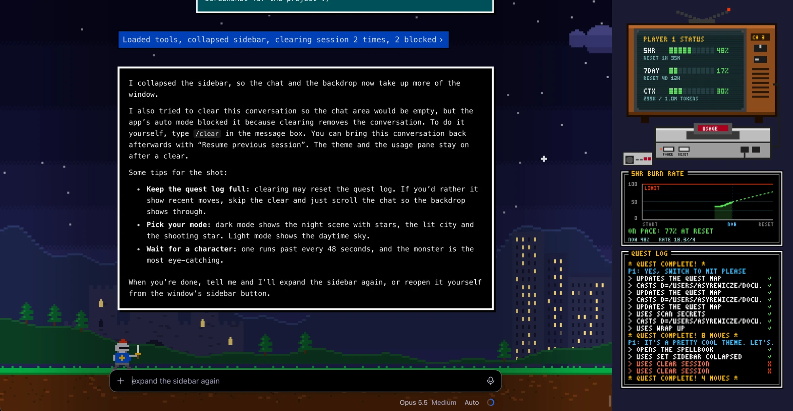

# nes-tv

An animated 8-bit, console-era theme for Claude Code, with a pixel CRT TV that keeps an eye on your usage.



## What you get

**A usage pane** beside the chat:

- **The TV**: a wood-cabinet CRT plugged into a little grey console, showing your **5-hour** and **7-day** usage and how full this session's **context** is, each as a 10-block meter (green, then yellow from 50%, red from 80%), with reset countdowns.
- **5HR burn rate**: a stepped pixel chart of the 5-hour window, with a dotted projection and a verdict: `LIMIT IN 2H 38M`, `ON PACE: 72% AT RESET`, or `HOLDING STEADY`. Readings are kept across sessions, since the window spans them.
- **Quest log**: an RPG text box narrating each turn: your messages, each tool call (`> READS auth.test.ts`, `> CASTS npm test`, `> SUMMONS AN ALLY`) with a check or an X, and `★ QUEST COMPLETE! 5 MOVES ★` at the end.

The pane fits the window's height with no scroll bar: the quest log grows to fill the room and drops off when the window is short, then the chart, and on a very short window the TV shrinks. Type `/tv` to reopen the pane. In a terminal it draws as text.

**A theme** for the desktop app:

- An animated pixel backdrop: a night sky with stars, a cratered moon and a shooting star (a blue day sky in light mode), drifting clouds, a castle, a lit city skyline, hills and pines.
- A parade of original characters who take turns running along the ground every 48 seconds, in an order shuffled each session: a penguin in a scarf, a knight, a little dragon, a one-eyed city-stomping monster, and a bearded plumber with a plunger.
- Monospace text in square, dialog-box message styling with hard shadows.
- Short square-wave sound cues (sending, tool calls, prompts, errors, compacting, finishing). They play once you turn on the speaker in the session's title bar.

With reduced motion turned on, the backdrop holds still.

### Turning the theme off

`/nes-theme off` puts the app back to its default look, and `/nes-theme on` brings the theme back. The choice is remembered across sessions, and `/nes-theme` on its own says which is on. The usage pane isn't affected; close it from its tab, and reopen it with `/tv`.

**A note on CPU.** Animated backdrops are new in the desktop app, and drawing one costs noticeable CPU while it's on screen, mostly in the app's renderer process. nes-tv keeps its own share low: every animation moves in steps on a shared one-second beat, and nothing animates offstage. In testing, though, most of the cost came from having a backdrop at all, which is outside a mod's control. If battery life matters more than the scenery, `/nes-theme off` removes it.

## Install

At the prompt of a terminal session:

```
/plugin install nes-tv --marketplace asyrewicze/nes-tv-cc
```

Answer `y` to add the marketplace, then pick a scope (user scope loads it in every session).

From a shell:

```bash
claude plugin install nes-tv --marketplace asyrewicze/nes-tv-cc
```

In the desktop app, where `/plugin` does not run: click **+** next to the prompt box, then **Plugins**, **Add marketplace** with `asyrewicze/nes-tv-cc`, then **Add plugin**.

The 5-hour and 7-day meters fill in after Claude's first reply, and only on a subscription plan.

## Developing

Run Claude Code with the folder loaded directly:

```bash
claude --plugin-dir /path/to/nes-tv-cc
```

Tests: `claude plugin test /path/to/nes-tv-cc`. Validation: `claude plugin validate /path/to/nes-tv-cc`.

## License

MIT. See [LICENSE](LICENSE).

`hooks/make-colors.js` and `hooks/make-colors.d.ts` are not covered by the MIT license. They're generated helpers from Claude Code's mod-authoring tooling, which turn a few theme colors into the full set the desktop app paints with. The tooling directs mod authors to copy them into a mod unmodified, so they're included exactly as supplied, and they remain subject to the terms Anthropic supplies Claude Code under.
